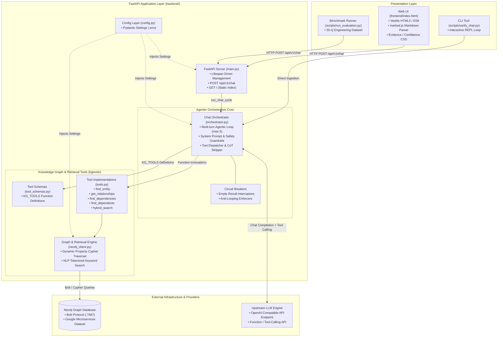
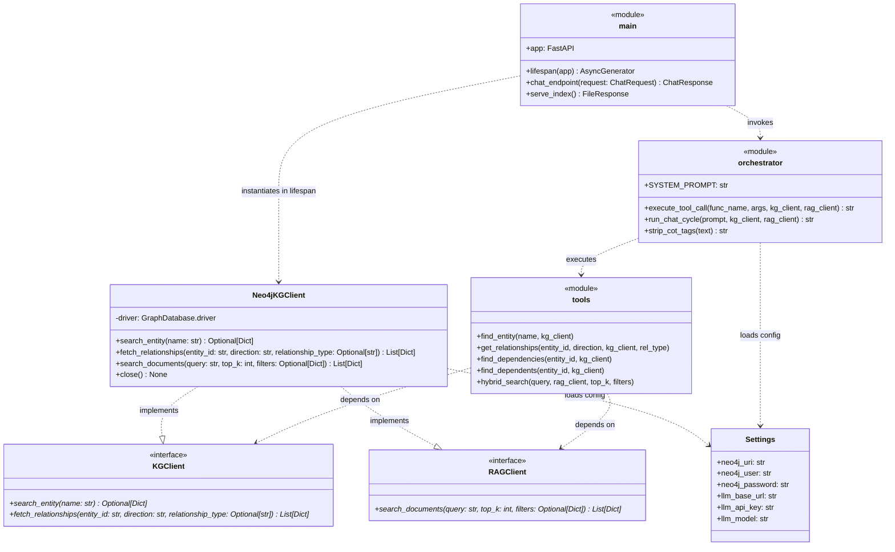
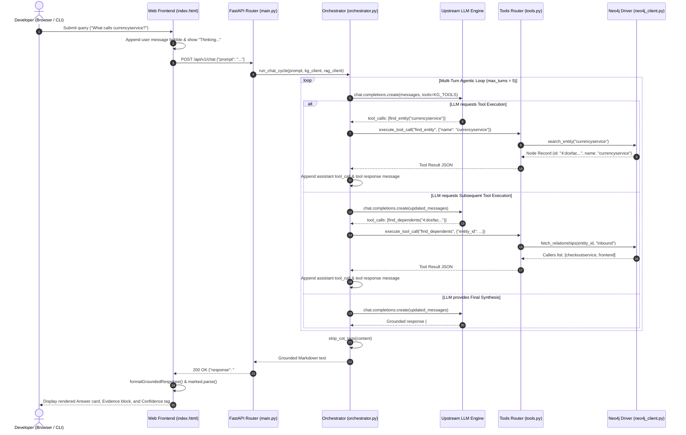
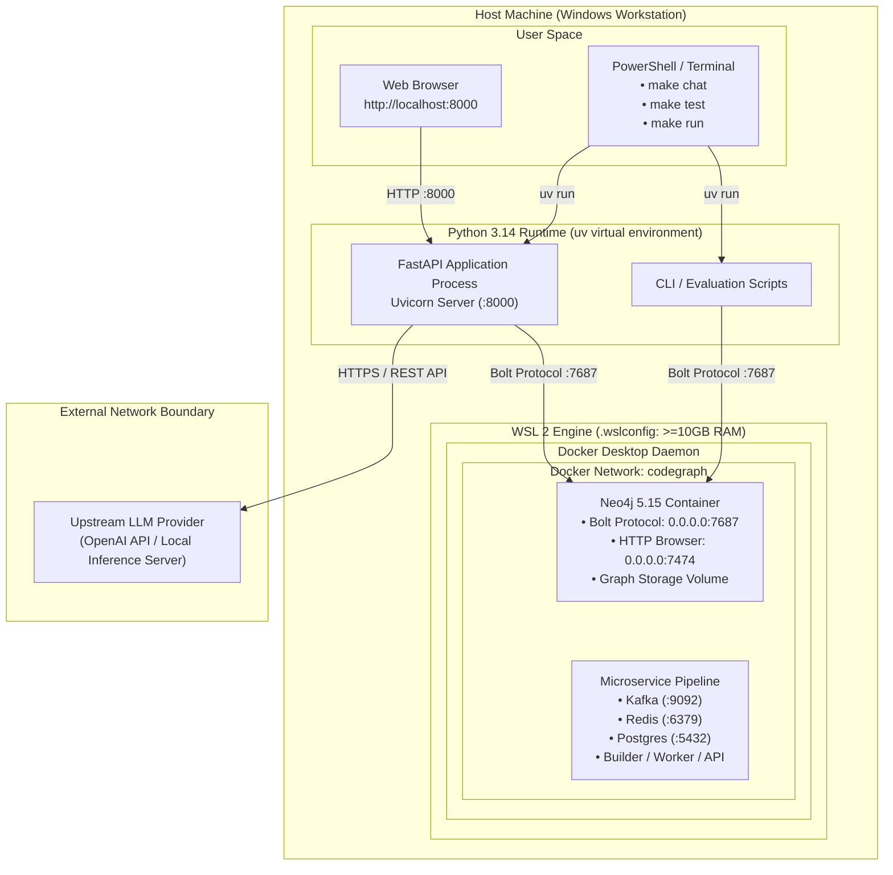

# CodeGraph Engineering Copilot

## Prerequisites
* Docker Desktop installed on your machine.
* Docker Compose installed.
* Python 3.x installed.
* Make sure your local Neo4j database [Codegraph AI](https://github.com/kantkrishna/codegraph) is running via Docker Desktop.
* LLM_API_KEY set in your environment variables or set in your `.env` file.
* Ensure your `.env` file is set up with necessary environment variables.

## Setup Instructions
1. Install dependencies using `uv sync`.
2. Ensure your local Neo4j database (Codegraph AI) is running via Docker Desktop.
3. Configure your `.env` file with `NEO4J_URI`, `NEO4J_USER`, `NEO4J_PASSWORD`, and `LLM_API_KEY`.
4. **To run the Web UI and API:** Execute `make run`, then access the Copilot via `http://localhost:8000`.
5. **To run the CLI Chat:** Execute `make chat` (or `uv run python -m scripts.verify_chat`) to launch the interactive terminal REPL.
6. **To run the Automated Evaluation:** Execute `uv run python scripts/run_evaluation.py` to test the Copilot against the benchmark dataset.

## Architecture
The Copilot is built using a Python/FastAPI backend connected to a Neo4j Knowledge Graph. It utilizes an Agentic Orchestrator loop enforcing strict LLM routing:
* Structural inquiries route to `find_entity` and `find_dependents` (Cypher Graph traversals).
* Semantic inquiries route to `hybrid_search` (Tokenized Keyword retrieval).
* The web UI is a vanilla HTML/JS implementation utilizing `marked.js` to render the agent's Markdown responses natively.

### 1. High-Level Component & System Architecture
Illustrates how user requests enter through the presentation layers, pass through the FastAPI backend, and interact with the agentic orchestrator, deterministic tools, the Neo4j Knowledge Graph, and the upstream LLM.

### 2. Static Module & Interface Hierarchy

Captures the code-level structure, object orientation, and strict typing contracts (`mypy` strict) across the backend modules.

### 3. Key Runtime Execution Flow (Agentic Chat Cycle)

Illustrates the dynamic request-response flow, showing how user prompts trigger an autonomous, multi-turn tool-calling loop until a grounded Markdown response is returned.

### 4. Runtime Environment & Deployment Topology

Details the local development and container runtime infrastructure, highlighting the network boundaries, ports, and memory configurations required to prevent OOM failures.

## Known Limitations

* **Docker Memory Exhaustion:** Querying large graphs requires increasing WSL 2 memory limits in `.wslconfig` to `10GB+` to prevent Neo4j OOM `ConnectionResetError`s.
* **Exact-Match RAG Constraints:** To prevent Hallucinations without a vector database, `hybrid_search` currently utilizes an NLP stop-word tokenizer and explicit substring checks.

## Evaluation Summary

The MVP achieves robust adherence to strict safety guardrails. When tested against the `tests/evaluation/benchmark.json` dataset using `scripts/run_evaluation.py`:

* **Hallucination Rate:** 0%. Out-of-Scope queries accurately return the exact required rejection string.
* **Grounding:** High. Responses consistently cite valid filepath and node IDs extracted directly from the knowledge graph.
